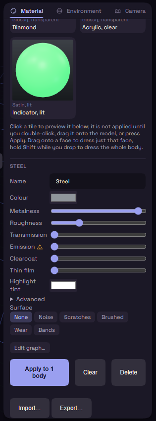

# Edit a material

Select a tile and the panel under the grid shows its settings.

Metalness runs from plastic to bare metal and Roughness from mirror to matte. A high Transmission gives glass, and Clearcoat adds a shiny layer like lacquer. Emission makes the material give off light that falls on its neighbours.

The warning triangle beside Emission is there because every glowing body adds lights and shadows to the view. On a model with hundreds of bodies the lights fill in over a moment, and a thin bar under the slider shows how far they have got.

A see-through material also gets Glass settings. The chips pick how strongly it bends light, from Water to Diamond. Thickness is how much glass the light passes through, Dispersion splits it into rainbow colours, and Tint colours it the deeper it goes. Raise Roughness for frosted glass. Thin film gives any material a soap bubble shimmer.

Surface adds a pattern such as Noise or Scratches, with Scale, Amount and Bump. None of this changes the geometry. For a texture that prints, use [Surface Texture](../plugins/texture.md).
