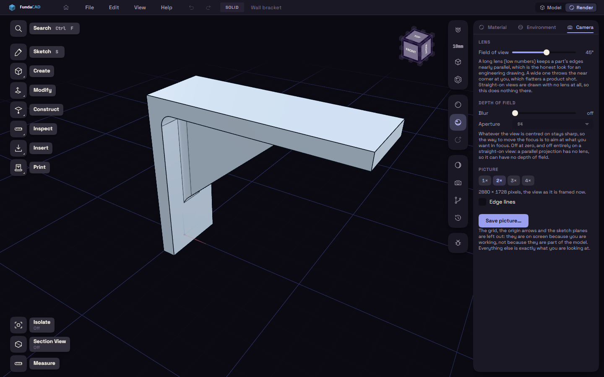

# Environment and camera

The Environment tab sets the room the part sits in, and the Camera tab sets the lens.

Studio offers six lighting setups. A metal part reflects its room, so with none it looks nearly black, and Flat shows the shape most clearly. Bloom lets light spill off bright parts, and Shadows switches cast shadows.

Under Ground, Shadow puts a soft shadow under the model, set apart for the Model and the Render workspace. It is off by default and is not drawn on the lightweight render. Path traced shows the Ground shadow too.

A low Field of view looks like a technical drawing, and a high one looks wider. To make an image, pick a size from 1x to 4x under Picture and press Save picture.
