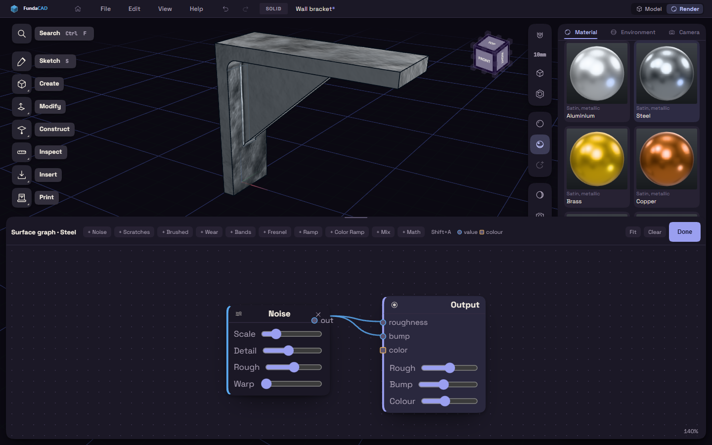

# The node editor

The node editor builds a surface pattern of your own from small blocks called nodes. It opens along the bottom of the screen, with your part above it as a live preview.

## Build a graph

1. Select a material and press Edit graph… under Surface.
2. Add a node with the + buttons along the top, or press Shift+A for a menu at the pointer.
3. Drag from a node's out dot to an input dot of another node, or click one dot and then the other.
4. Wire the last node into Output, which takes roughness, bump and color.
5. Press Done.

The node list has Noise, Scratches, Brushed, Wear and Bands for patterns, Fresnel, Ramp, Color Ramp, Mix and Math to shape them.

## Find your way around

- A dot's colour says whether it carries a value or a colour, and only the same kind connect.
- Click a wired input to unplug it. The cross on a node removes it.
- Drag the background to pan and scroll to zoom. Fit brings every node into view.
- Clear starts over with only the Output node.
- Drag the top edge of the editor to make it taller.
