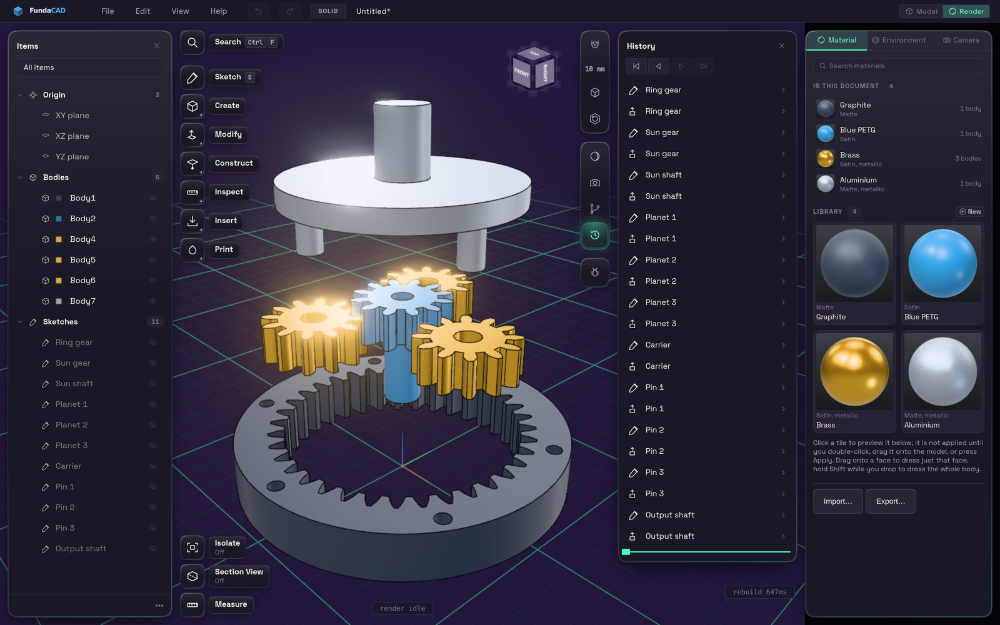

# Materials and rendering

Materials change how a part looks on screen, not how it prints. They are for telling parts apart while you work, for checking how a finish will read, and for making a picture you can show someone.

Switch to the Render workspace with the Model and Render buttons in the title bar, or with Materials in the Edit menu. Render gives you a side panel with three tabs: Material, Environment and Camera.

## The material library

The Material tab starts with a search box and the Library, a grid of finishes. If your model already uses some of them, those are listed above it under In this document, with a count of the bodies and faces that wear each one.

Clicking a tile previews it in the panel but does not change the model. To use a material, double-click it, drag it onto the part, or select the part and press Apply. Dragging onto a face dresses only that face, and holding Shift while you drop dresses the whole body. To take a material off again, select the part and press Clear.

New makes a fresh material to edit. Import and Export at the bottom of the tab load and save the whole library as a file, which is handy for carrying your finishes from one project to the next.

## Editing a material

Select a tile and the panel under the grid shows its settings. Metalness runs from plastic to bare metal, and Roughness from a mirror to a matte surface. Opacity lets light through, so a low value gives you glass or a clear plastic. Clearcoat adds a thin shiny layer on top, like lacquer on a car.

Glow makes the material give off light, and a glowing part also throws a soft light on the parts next to it. If you want the glow to spill over the edges as well, turn on Bloom on the Environment tab. The panel reminds you when Glow is up and Bloom is off.

Under the sliders, Surface adds a fine pattern to the finish: Noise, Scratches, Brushed, Wear or Bands. Scale sets how big the pattern is, Amount how strongly it shows, and Bump how much it looks raised. Tint and Tint amount mix a second colour into the pattern, which is how you get a dirty or worn look.

None of this changes the geometry. If you want a texture that is real shape and ends up in the print, use the [Surface Texture](../plugins/texture.md) plugin.

## The graph editor

When the patterns are not enough, Edit graph opens a node editor along the bottom of the screen, with your real part above it as the live preview. Press Shift+A to add a node. There are pattern nodes (Noise, Scratches, Brushed, Wear, Bands), a Fresnel input, Ramp and Color Ramp, and Math and Mix. You connect them by dragging from one dot to another, and everything ends in an Output node that takes roughness, bump and colour.

Drag the top edge of the editor to trade graph space for preview space. Fit centres the graph, Clear empties it, and Done closes the editor. While a material has a graph, its Surface pattern setting is ignored.

## Environment

The Environment tab sets the room the part sits in. Studio offers six lighting setups: Studio, Soft box, Warm key, Dusk, Bright room and Flat. A metal part is nearly all reflection, so with no room to reflect it looks almost black. Flat has no reflections at all and is the clearest way to read the shape.

Ground sets the background, and Brightness raises or lowers the lights and reflections together. Key light has an Aim button, which lets you drag a sun around on the model to swing the light that casts the shadows. Bloom sets how much light spills off the brightest parts, and Shadows switches cast shadows on or off.

Performance mode and Potato mode lower the quality for a slow machine. They are the same two switches as in [Preferences](../reference/preferences.md#viewport).

## Camera and pictures

On the Camera tab, Field of view is the setting to know. A low number gives a long lens whose edges stay nearly parallel, which looks like a technical drawing, and a high number looks wider and more dramatic. Depth of field blurs what is away from the centre of the view. Set Blur above zero to turn it on, and aim the view at whatever should stay sharp.

<!-- shot: render-camera-tab | The Camera tab with Field of view and Depth of field sliders next to a rendered part -->

To make an image, choose a size from 1x to 4x under Picture, decide whether you want Edge lines, and press Save picture. The grid, the origin arrows and the sketch planes are left out of the picture, and everything else is as you see it.
