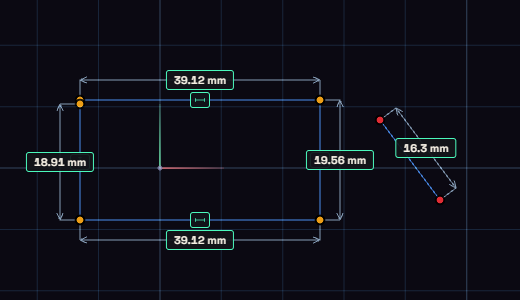

# Constraints

A constraint is a rule the sketch keeps true, such as "this line stays horizontal". Change one size and everything that depends on it moves.

Blue curves can still move, white curves are fully defined, and red means two rules disagree.

A line drawn within about 3 degrees of horizontal or vertical is made exact for you. For everything else, pick a constraint from the Constrain button and click the shapes it needs. Right-clicking a selection lists only the constraints that fit it.

The Relations list at the bottom of the palette shows every rule, one row each. Hover to see where it applies, and use the x to delete it.

## Loose ends

A sketch that will not extrude usually has a gap. While you sketch, a red dot marks an end that touches nothing, and an amber dot an end that meets another curve only by position, with nothing holding it there. Tie Loose Ends, next to Constrain, gives every amber end a coincident or on curve constraint in one undo step, and the "no closed profile" message offers the same button. A red end needs a line drawn to close it.

