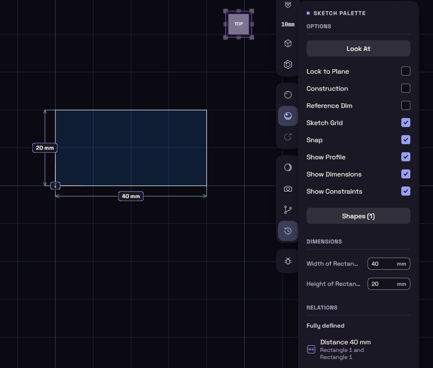
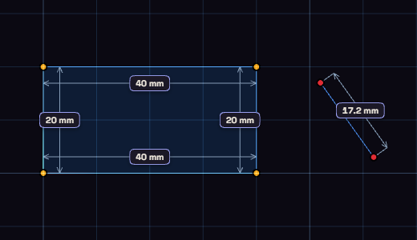

# Constraints

A constraint is a rule the sketch keeps true, such as "this line stays horizontal". Change one size and everything tied to it moves with it.

The colour of the curves tells you how free the sketch still is:

1. **Blue**: the sketch can still move.
2. **White**: the sketch is fully defined, nothing can move.
3. **Red**: two rules disagree.

## Add a constraint

Some come for free as you draw a line. With both ends on the grid, a line whose ends share a grid row or column is made horizontal or vertical. With an end off the grid, as with Snap off or Ctrl held, a line within about 3 degrees of horizontal or vertical is made exact.

1. Open **Constrain** on the rail and pick one, or press its key.
2. Click the shapes the hint line asks for.
3. Keep clicking to add more, press Esc to stop.

With shapes already selected, a constraint that fits them applies at once. Right-click a selection to see only the constraints that fit it.

| Constraint | Key | Click |
|---|---|---|
| Horizontal | H | a line |
| Vertical | V | a line |
| Parallel | Shift+P | two lines |
| Perpendicular | N | two lines |
| Equal | Shift+E | two lines, or two circles or arcs |
| Tangent | G | two curves |
| Coincident | I | two endpoints |
| Concentric | Shift+C | two circles or arcs |
| Midpoint | Shift+M | a point, then a line |
| Collinear | Shift+L | two lines |
| Symmetric | Shift+S | two endpoints, then the axis |
| Fix | Shift+F | a point or a circle centre, to lock it |

## Remove a rule from the drawing

Click a rule's icon on the sketch to select it. Its shapes light up, and its row in the Relations list is marked as current. Press **Delete** to remove it, and the sketch says "Deleted" and the rule's name. **Ctrl+Z** brings it back, and **Escape** or a click elsewhere drops the selection. An icon on a pattern opens the pattern instead.

## The Relations list

The palette lists every rule under **Relations**, one row each. It shows while **Show Constraints** is on.

1. The line on top says how free the sketch is, such as "2 degrees of freedom" or "Fully defined". When it changes, it is spoken too, and conflicting rules are spoken at once. Opening a sketch says nothing.
2. Each row is a button. Tab to it, or hover it, to light up what it holds. Enter, Space or a click selects those shapes.
3. A row says its state in words as well as colour: "conflicting" for a rule that cannot hold, "redundant" for one that repeats another, "reference" for a measure that does not drive.
4. Each rule has its own **Delete** button, named after the rule, such as "Delete Distance 12.5 mm, Line 1 and Line 3". It shows when you hover the row or Tab into it. With a row focused, Delete or Backspace does the same. Focus then moves to the row that took its place, or the one above.
5. A dashed icon marks ends held only by where they sit, listed as "implied". There is nothing to delete there.
6. The row of the rule you selected on the sketch is marked as current.

## Loose ends

A sketch that will not extrude usually has a gap. While you sketch, dots mark the ends that keep it open:

1. **Red dot**: an end that touches nothing.
2. **Amber dot**: an end that meets another curve, but no rule holds it there.

**Tie Loose Ends**, next to Constrain, ties every amber end in one step you can undo. When red ends sit close together, up to a tenth of the sketch's size and at most 10 mm, it offers **Close gap** to tie them across. Farther apart, draw a line to close them.

When Extrude finds no closed profile, its message offers the same buttons. On a small gap, press Extrude again to get a thin wall along the lines instead.

