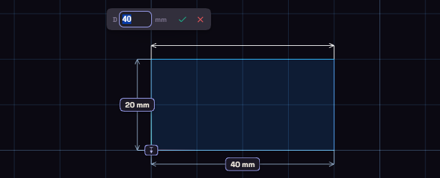

# Dimensions

A dimension is a constraint with a number in it, such as a length of 40 mm.

1. Press D, or click Dimension on the rail.
2. Click a line or circle. Click a second thing for the distance or angle between them.
3. Click where the number goes, then type the value and press Enter.

Double-click a number to change it later, right-click it to delete it. A dimension also takes a parameter name or an expression such as `width / 2`, which the [parameters page](../model/parameters.md) explains.

## The Dimension menu

Right-click while the Dimension tool runs for the choices a click cannot make.

- Pick Circle/Arc Tangent: the next click on a circle or arc measures to its edge, not its centre.
- Reflex angle: an angle measures the outside of the wedge.
- Radius or Diameter: what a lone circle or arc shows.
- Driven (reference): the dimensions you place next are reference dimensions.

A reference dimension shows a size but never moves the sketch, and you cannot type into it. Reference Dim in the palette is the same switch. Lengths and diameters cannot be reference dimensions yet.
