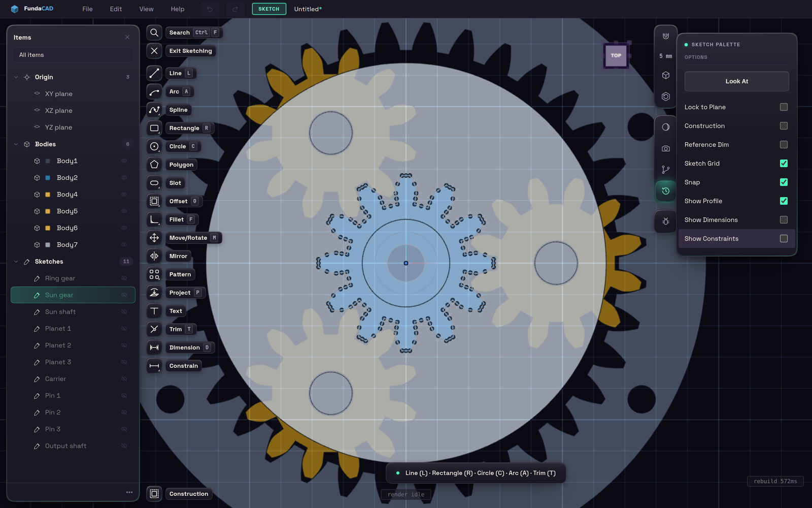

# Drawing in a sketch

A sketch is a flat drawing that lives on a plane or on a face of your part. Most parts start as one: you draw an outline, close it, and pull it into a solid.

## Starting a sketch

Press S, or pick Sketch on the rail, and the three origin planes light up. Click one, or click any flat face of a body, and the sketch opens on it. If a flat face is already selected when you press S, the sketch starts on that face straight away. A round face gives you the plane that touches it at the spot you clicked.

You can also click the XY, XZ or YZ row under Origin in the Items card. XY is the floor, so a sketch there is a plan view from above.

The letters for the drawing tools work from outside a sketch too. Pressing L, C, R, A or P in the model view asks for a plane and then opens the sketch with Line, Circle, Rectangle, Arc or Project already running.

<!-- shot: sketch-overview | an open sketch with a few shapes, the sketch tools on the rail and the sketch palette -->

## Drawing shapes

While a sketch is open the rail holds the drawing tools, and the line of text at the bottom of the view says what the running tool wants next. Similar tools share one button. Rectangle holds the corner, centre and three-point versions, and Circle holds the plain, two-point and three-point versions. The button runs the one you used last. To pick another, right-click the button or hold it down for a moment.

Line (L) takes a click for each point and keeps chaining until you press Esc. Rectangle (R) takes two opposite corners, and Circle (C) takes a centre and then a point on the rim. Arc (A) takes a start, an end, and then a third point the arc passes through.

Polygon takes the centre and then one corner, and the number of sides is a box you can type into. Slot takes the two arc centres and then the width. Point drops a single point, which is handy as something to dimension to.

Spline runs a smooth curve through the points you click, and Enter finishes it. Control Point Spline works on a different idea: the points you click pull the curve towards them without sitting on it, and clicking the first point again closes the curve. If you want to reshape a finished Spline that way, right-click it and choose Edit as Control Points.

Text opens a small panel where you type the words, pick a font, and set the size, angle and alignment. Ctrl+Enter places it. Text turns into closed shapes, so it extrudes like anything else, and cutting it into a face engraves it.

## Typing exact sizes

While a shape hangs on the cursor, small boxes next to it show its length, angle, width or radius. Move the mouse and the numbers follow. Type a number into a box and it holds that value from then on, wherever the mouse goes.

A rectangle shows a width box and a height box. Click the first corner, type 40, press Tab, type 25 and press Enter, and you have a 40 by 25 rectangle without touching the mouse again. Tab locks the box you are in and moves to the next one. You can type a unit with the number, such as `2 in`, and it is converted to the unit the document uses.

## Snapping and the sketch palette

The cursor snaps to the endpoints, midpoints and centres of what you have already drawn, and a small label names the spot it found. It also lines up with those points along the horizontal and vertical of the sketch and draws a guide line when it does. With no point nearby it falls back to the sketch grid.

Snap and Sketch Grid are switches in the sketch palette, the panel that holds the settings of the sketch you are in. Turn them off to place something freely. Look At in the same panel turns the view square onto the plane again after you have orbited away, and Lock to Plane keeps the camera there.

Construction makes whatever you draw next into guide geometry. Construction lines are drawn in orange and never become part of the outline, so they are good for centre lines and for things to snap or constrain against. Show Profile, Show Dimensions and Show Constraints decide what is drawn on the canvas.

## Changing what you drew

With no tool running, a click selects a shape and it turns orange. Drag a point or a line to move it, and press Delete to remove the selection. A right-click offers Delete plus any constraints that fit what you selected.

Fillet (F) rounds the corner between two lines, and you type the radius. Chamfer cuts the same corner off straight. Trim (T) removes the piece of a curve up to where it crosses its neighbours, Extend grows a line or arc to the next thing it meets, and Break splits one where you click.

Offset (O) draws a parallel copy of a curve or of a face edge. Move the mouse to pick the side, or type a distance. A right-click while it runs offers Chain Selection, which offsets the whole connected outline, and Flip.

Mirror asks for the shapes and then for the line to mirror across. Move/Rotate (M) asks for the shapes, then a point to move from and a point to move to. Copy, Rotate and Scale also start from the shapes you pick, but they are not on the rail. Press Ctrl+K and type the name to run one.

## Using the model with Project

Project (P) copies existing geometry into the sketch so you can draw against it. Click an edge of a body, click a face to take its outline, or click a curve from an earlier sketch. A row of chips appears while the tool runs, and it switches between Edges & faces, Sketch curves and Body silhouette.

Projected curves are purple and stay linked to what they came from, so they follow the model when it changes. They cannot be dragged for that reason. To turn one into an ordinary curve, select it and choose Break Link from the right-click menu. Project only sees what was made before the sketch in the History.

## Leaving the sketch

Esc backs out one step at a time. The first press drops whatever you are halfway through drawing, the next clears the selection, the next stops the tool, and only when nothing is left does it leave the sketch. To leave on purpose, click Exit Sketching near the top of the rail.

Pressing E or Q inside a sketch finishes it and starts Extrude or Press/Pull in one go. Ctrl+Z steps back through the sketch one action at a time while you are in it.
