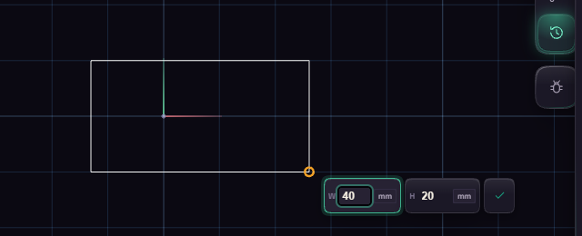

# Type exact sizes

While a shape hangs on the cursor, small boxes show its length, angle, width or radius. Type a number into one and it holds that value wherever the mouse goes.

Click the first corner of a rectangle, type 40, press Tab, type 25 and press Enter. Tab locks the box you are in and moves to the next.
