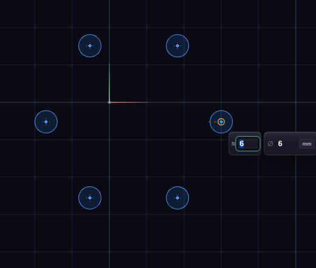

# Hole patterns

Four pattern tools draw the circles themselves, so there is nothing to select first. Click the middle, move the mouse to set the size, type the counts and click again.

Bolt Circle places holes around a circle, and it offers six holes of 6 mm to start. Grid Holes makes a rectangular array with Nx and Ny. Hex Holes packs holes in a hexagonal layout, and Rings sets how many rows surround the centre one. Honeycomb uses the same layout with six-sided cells.

Extrude treats all the copies as part of the sketch, so a plate with a pattern of holes cuts them in one go.
