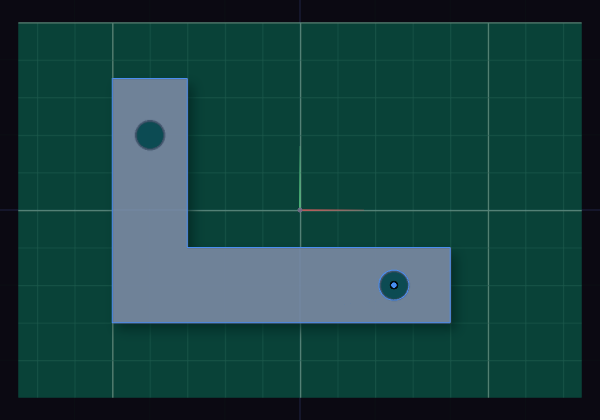

# Reference images

Put a photo or a drawing on a plane and sketch over it. For example, photograph a broken part on a cutting mat, scale the photo to a length you know and redraw the part on top.

## Insert an image

1. Choose Reference Image under Insert on the rail.
2. Click a base plane, a datum plane or a flat face.
3. Pick a PNG or a JPEG, up to 32 MB.

The image lands 100 mm wide and half transparent. It gets a row under Reference images in the Items card.

## Scale it to a real size

1. Click the image's row to open its panel, and press Calibrate.
2. Click two points on the image whose distance you know, for example two marks 100 mm apart on the mat.
3. Type that distance and press Enter. A unit works too, such as `4 in`.

The image scales about the first point, so that point stays put. To set a size without two points, type a Width in the panel instead.

## The panel

| Field | What it does |
| --- | --- |
| Width | the size, about the centre; the Height follows the picture |
| Angle | turns the image on its plane, in degrees |
| Opacity | how much of the model and the grid shows through |
| Flip X, Y | mirrors a photo taken from the other side |
| Lock | stops moving and calibrating by accident |

Shift drag the selected image to move it along its plane. Each drag, calibration and panel change is one step of Undo.

## Show, hide and delete

1. The row in Items has an eye to hide the image, a lock and a cross to delete it. Double-click its name to rename it.
2. The Display popover hides every reference image at once.
3. A sketch on the same plane draws over the image.

## Files, pictures and exports

1. The image is saved inside the .funda file. A row that says image not found means it is not in the file, so insert it again.
2. Exports leave the images out. Save picture in the Render Camera tab keeps them only with Reference images ticked.

An image on a datum plane follows the datum when it moves. An image on a face keeps the plane the face had when you picked it.
