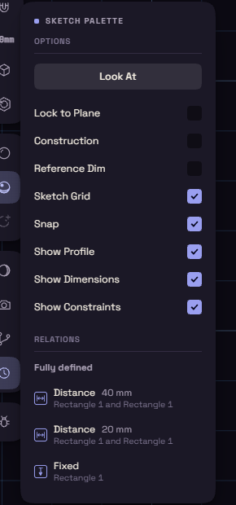

# Snapping and the palette

The cursor snaps to what you have drawn and names the spot it caught, such as Endpoint, Midpoint or Center. Near no point, it lines up with one, then falls back to the sketch grid.

Hold Ctrl while you click to place a point exactly under the cursor.

## The sketch palette

The palette holds the options of the sketch you are in.

| Option | What it does |
| --- | --- |
| Look At | Turns the view square onto the sketch plane again. |
| Lock to Plane | Stops the view from turning off the plane. Off at first. |
| Construction | What you draw next becomes construction geometry. |
| Reference Dim | New dimensions only measure, see [Dimensions](dimensions.md). |
| Sketch Grid | Shows the grid. |
| Snap | Snaps to the grid and onto lines. Off, the cursor still catches points. |
| Show Profile | Shades the closed regions. |
| Show Dimensions | Shows the dimensions. |
| Show Constraints | Shows the constraint marks and the Relations list. |

## Construction geometry

Construction geometry is drawn dashed in orange and is never part of an outline. Use it for centre lines and for things to constrain against.

To turn lines you already drew into construction, select them, then click Construction at the foot of the rail or in their right-click menu.
