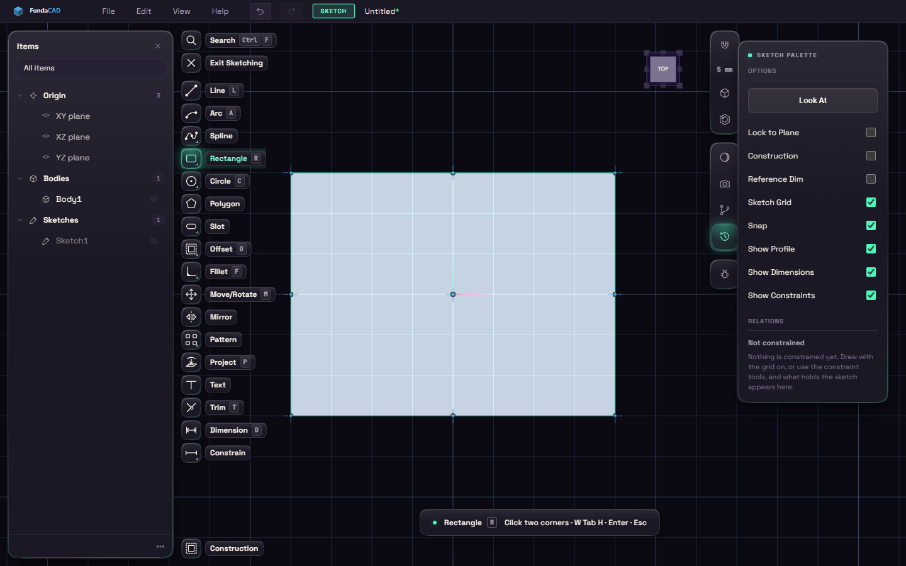

# Start a sketch

A sketch is a flat drawing on a plane or on a face. Most parts begin as one.

Press S and click one of the three origin planes, or any flat face of a body. If a flat face is already selected, the sketch opens on it straight away. XY is the floor, so a sketch there is a view from above.

Esc backs out one step at a time, and Exit Sketching on the rail leaves on purpose. Pressing E or Q inside a sketch finishes it and starts Extrude or Press/Pull.
