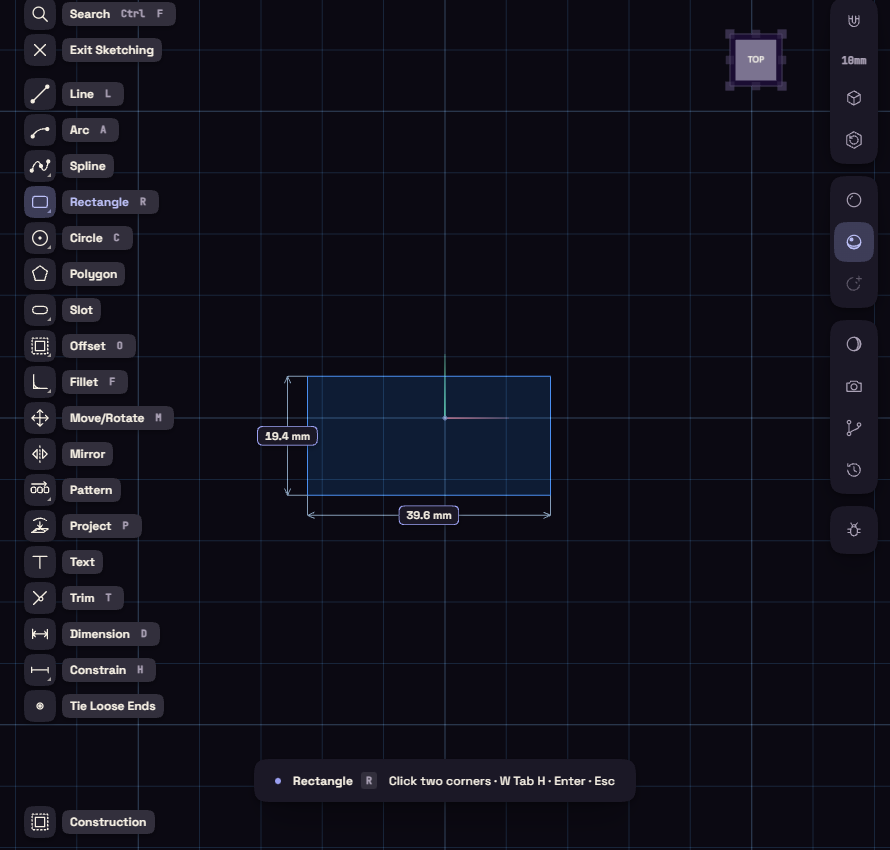
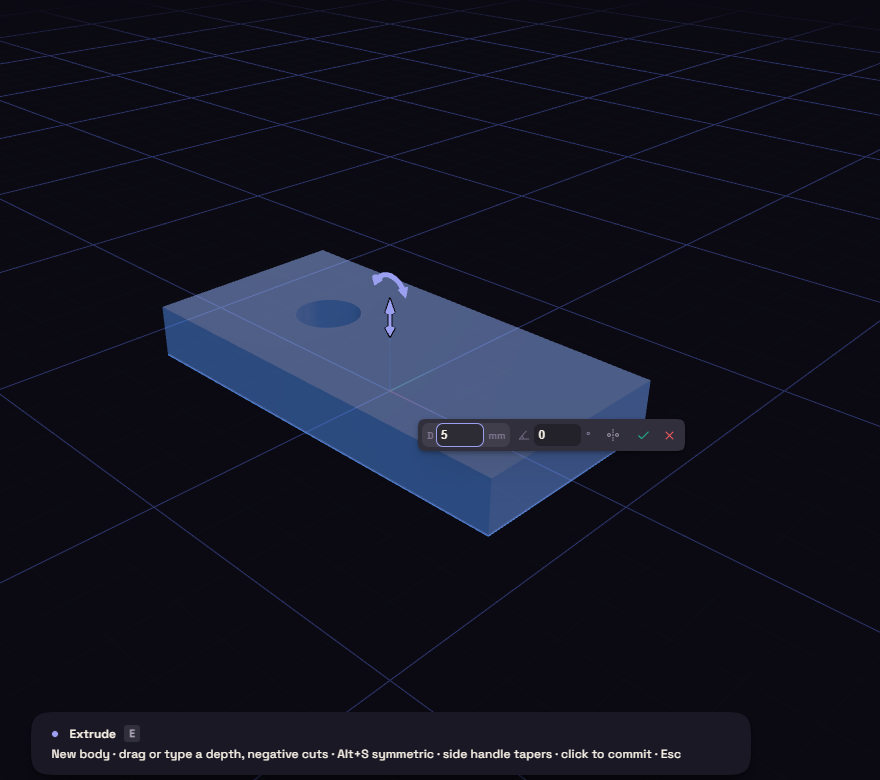
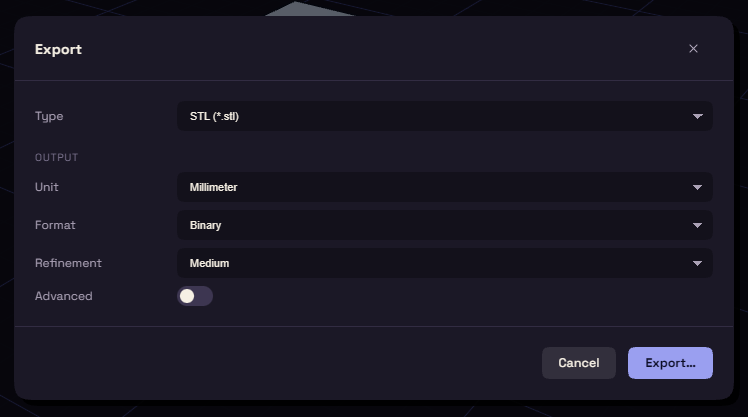

# Your first part

This makes a plate 40 mm by 20 mm and 5 mm thick, with a 6 mm hole, and exports it for your slicer.

## Sketch it

1. On Home, click **Blank**.
2. Press S and click the XY tile beside the origin, the one lying flat on the floor.
3. Press R and click two opposite corners.

## Size it

1. Press D, click the bottom edge, type 40 and press Enter.
2. Click a side edge, type 20 and press Enter.
3. Press C and draw a circle inside the rectangle.
4. Press D, click the circle and type 6 for its diameter.

## Make it solid

1. Press E and click inside the rectangle, outside the circle.
2. Drag the arrow up, or type 5 and press Enter.

## Change your mind

Click the Extrude step in the History and change 5 to 8, the plate follows. To round an edge, press F, click the edge and type a radius.

## Save and export

Ctrl+S saves a `.funda` file that keeps the whole history. Ctrl+E opens the Export window, where STL with Millimeter and Medium suits most slicers.

